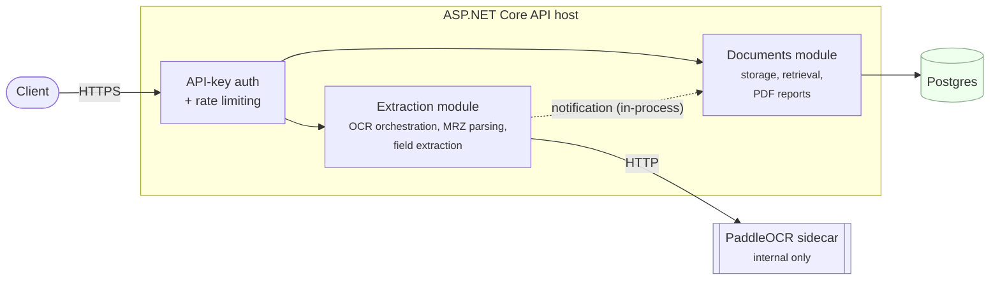
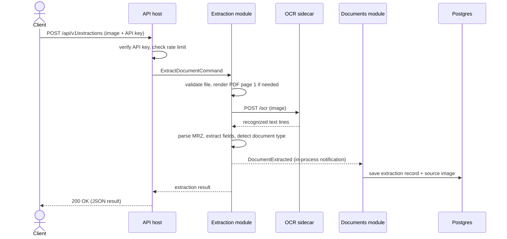
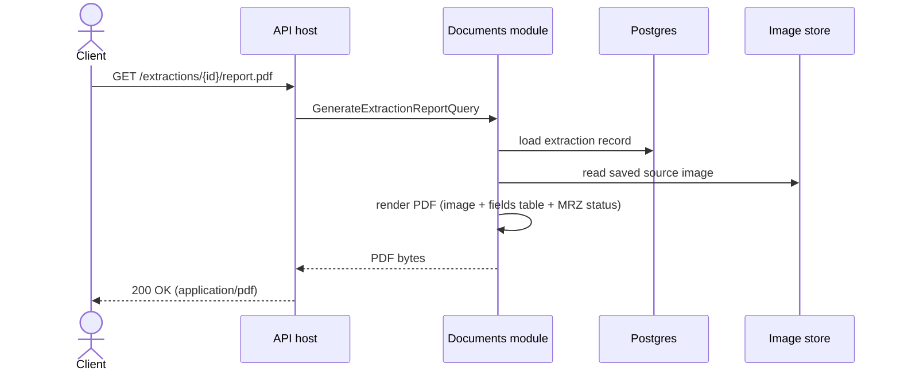

# ID Details Extractor

A REST API that reads identity documents — passports, national ID cards, driving
licences, from any country — and gives you back the details on them (name,
document number, date of birth, expiry date, and so on) as structured JSON, plus
a PDF report you can file or hand to someone else.

It works by running the document image through OCR (text recognition), then
looking for a machine-readable zone (the two or three lines of letters, numbers
and `<` characters printed at the bottom of most passports and ID cards) and
parsing it, since that zone follows an international standard and is far more
reliable than trying to read the rest of the document by eye. When there's no
such zone — most driving licences, for example — it falls back to looking for
labels like "Date of Birth" or "Licence No" near the values on the page.

## Why it exists

Manually typing details off an ID document is slow and error-prone. This gives
you an API you can point a scanned image or photo at and get back a clean,
structured answer — using open-source OCR by default, so there's no per-document
cost and no image ever has to leave your own servers, with an optional cloud OCR
provider available for higher accuracy on photos when configured.

## How a request flows through the system

The service is a **modular monolith**: one deployable API, internally split into
two independent modules that never call each other directly — they only pass
messages through an in-process bus (MediatR). This keeps the codebase organized
like separate services would be, without the operational overhead of actually
running separate services.



The **Extraction module** does the actual document reading: it validates the
upload, calls the OCR engine, looks for and parses a machine-readable zone,
extracts whatever fields it can find, and guesses the document type. The
**Documents module** owns everything about *storing* the result: it listens for
"a document was extracted" and saves the result and the source image, and it's
the only module that talks to the database or builds PDF reports.

### Submitting a document (`POST /api/v1/extractions`)



The response comes back as soon as the extraction itself is done — saving to the
database happens as part of the same request, so by the time you get your `200
OK` the result is already retrievable by its `id`.

### Getting a PDF report (`GET /api/v1/extractions/{id}/report.pdf`)



## What's under the hood

| Concern | Choice |
|---|---|
| API | .NET 10, ASP.NET Core minimal APIs, modular monolith |
| In-process messaging | MediatR 12.5 (pinned — the last free-to-use version) |
| Result handling | Ardalis.Result — handlers return `Result<T>`, translated to proper HTTP status codes |
| Database | PostgreSQL, via EF Core |
| OCR (default) | PaddleOCR, running in a separate internal-only Python/FastAPI container |
| OCR (optional) | Azure AI Vision, config-gated, for higher accuracy on photos |
| PDF reports | NetPdfKit |
| Auth | API keys (`X-Api-Key` header), hashed at rest |
| Logging | Serilog, with extracted personal data automatically redacted before it can be logged |
| Tracing/metrics | OpenTelemetry, exportable to any OTLP-compatible backend |
| API docs | Scalar (interactive OpenAPI reference), versioned URLs (`/api/v1/...`) |

Every database row that could hold extracted personal data (names, document
numbers, dates of birth, MRZ text) is also written to an audit log — one row per
change, saying *who* changed *what* and *when* — but the audit log itself never
stores the actual field values, only that a change happened.

## Running it locally

### Option A: Docker Compose (recommended)

This starts everything — the API, the OCR sidecar, and Postgres — in one command.

```bash
cp .env.example .env
docker compose up --build
```

The API is then available at `http://localhost:8080`. The default API key for
local use is `dev-local-key` (its hash is what's in `.env.example` — see that
file if you want to use your own key instead).

> **Known limitation:** if you're running Docker on an ARM64 host under
> virtualization (for example, certain sandboxed/CI environments), PaddleOCR's
> underlying inference engine can crash with a segmentation fault — this is a
> [documented upstream issue](https://github.com/PaddlePaddle/PaddleOCR) in
> PaddlePaddle itself on ARM64, not something in this codebase. It has not been
> observed on standard x86_64 deployments or on native (non-virtualized)
> Apple Silicon. Everything except the actual OCR inference step — request
> handling, auth, MRZ parsing, storage, PDF generation — is covered by the
> integration test suite using a stubbed OCR provider, so this only affects the
> real PaddleOCR call itself.

### Option B: Run the API locally, Postgres in Docker

Useful if you're actively changing the .NET code and want fast rebuilds.

```bash
docker run -d --name idextractor-postgres \
  -e POSTGRES_USER=idextractor -e POSTGRES_PASSWORD=idextractor -e POSTGRES_DB=idextractor \
  -p 5432:5432 postgres:17-alpine

cd ocr-service
python3 -m venv .venv && source .venv/bin/activate
pip install -r requirements.txt
uvicorn main:app --port 8001 &

cd ../src/IdExtractor.Api
dotnet run
```

The API will apply database migrations automatically on startup. It listens on
whatever port `dotnet run` reports (check the console output); the API key
`dev-local-key` is already configured in `appsettings.Development.json`.

## Trying it out

Extract details from a document:

```bash
curl -X POST http://localhost:8080/api/v1/extractions \
  -H "X-Api-Key: dev-local-key" \
  -F "file=@/path/to/passport.jpg;type=image/jpeg"
```

```json
{
  "id": "019...",
  "documentType": "Passport",
  "documentTypeConfidence": 0.95,
  "fields": {
    "fullName": { "value": "ANNA MARIA ERIKSSON", "confidence": 0.95 },
    "documentNumber": { "value": "L898902C3", "confidence": 0.95 },
    "dateOfBirth": { "value": "1974-08-12", "confidence": 0.95 }
  },
  "mrz": { "raw": ["P<UTOERIKSSON<<ANNA<MARIA...", "L898902C3..."], "valid": true },
  "ocrProvider": "paddle"
}
```

Fetch the same result again later:

```bash
curl http://localhost:8080/api/v1/extractions/019... -H "X-Api-Key: dev-local-key"
```

List everything extracted so far:

```bash
curl "http://localhost:8080/api/v1/extractions?pageNumber=1&pageSize=20" -H "X-Api-Key: dev-local-key"
```

Download a PDF report — the original image plus the extracted fields on one page:

```bash
curl http://localhost:8080/api/v1/extractions/019.../report.pdf \
  -H "X-Api-Key: dev-local-key" -o report.pdf
```

When running via `dotnet run` (Option B), you can also browse and try every
endpoint interactively at `/scalar` — it's only enabled in the Development
environment, so it isn't exposed by the Docker Compose setup, which runs in
Production mode.

## Running the tests

```bash
dotnet test
```

This runs everything: unit tests for the MRZ parser (validated against
algorithmically-generated ICAO 9303 test vectors), field extraction, document
type detection, PDF report generation, and full end-to-end integration tests
that spin up a real (throwaway) Postgres database via Testcontainers.

For a codebase orientation aimed at contributors (layout, conventions, where to
add things), see [CLAUDE.md](CLAUDE.md).
